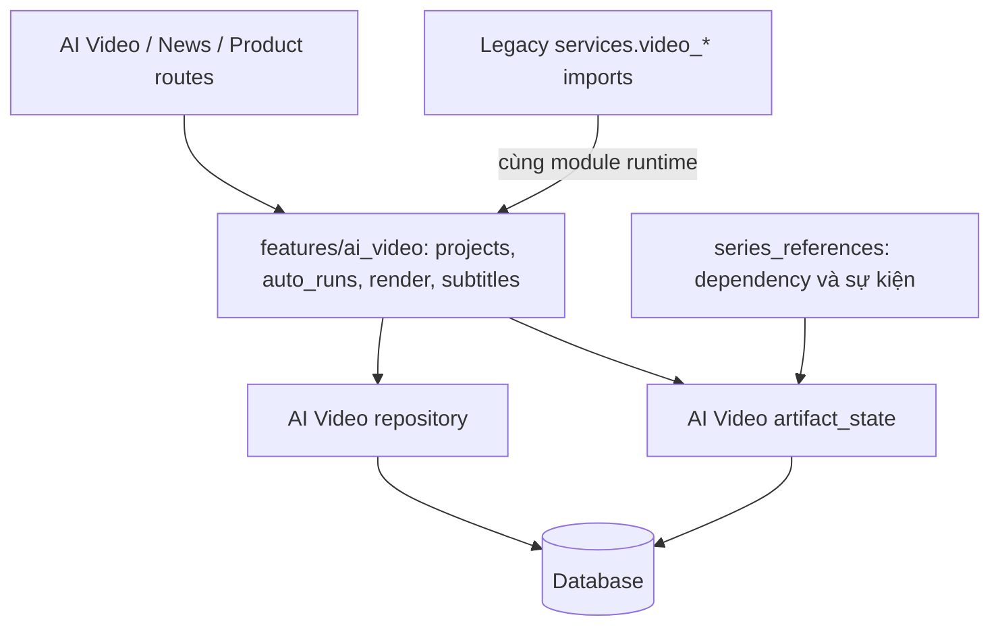

# Luồng dự án AI Video

## Đổi server và cache frontend

Web và desktop dùng `queryClient` cùng `QueryClientProvider` từ `app/src/lib/queryClient.ts`.
`serverStore.setServerUrl` cập nhật server trước khi gọi `resetServerQueries`.
Module cache hủy lượt truy vấn cũ, bỏ dữ liệu và `initialData` của server trước,
rồi tải lại những truy vấn đang được quan sát từ server mới. Đặt lại cùng URL
giữ nguyên cache. Các query function tiếp tục đọc URL hiện hành từ server store.

Nút tải prompt pack trong News Video đi qua mutation: tải `DownloadedBlob`,
chờ `platform.filesystem.saveFile`, rồi kết thúc trạng thái đang tải. Lỗi tải
hoặc lưu được hiển thị để người dùng thử lại. Web và desktop dùng adapter lưu
file tương ứng của từng nền tảng.

## Dependency và trạng thái kết quả sản xuất

`series_references` chọn dependency theo scope, ghi nhận sự kiện stale và gọi
`features/ai_video/artifact_state`. Module này cập nhật trạng thái kết quả thực
trong cùng transaction; caller quyết định commit hoặc rollback.

Có hai cách xác định đối tượng:

- Dependency cụ thể dùng ID thật của prompt, scene, shot, phụ đề, gói xuất hoặc bản dựng.
- Dependency của một công đoạn dùng `project_id`, `task` và `target_scope=project`
  trong metadata. Nó áp dụng cho các kết quả thuộc công đoạn của dự án, kể cả
  kết quả được tạo sau thời điểm tiếp nhận handoff.

Snapshot handoff cũ không có `target_scope` vẫn được nhận diện bằng source,
task và ID dạng `project:task`. Một snapshot chỉ chứa `project_id` vẫn được xử
lý như dependency cụ thể; nó không tự trở thành dependency của toàn công đoạn.

Thay đổi story thu hồi phê duyệt story/script, làm hết hiệu lực shot và kết quả
phụ thuộc. Với longform, phê duyệt dàn ý và fingerprint của bản cũ cũng hết hiệu
lực, nên phải phát triển và duyệt lại trước khi sản xuất. Thay đổi style giữ
nguyên voice và nội dung phê duyệt. Thay đổi lời/timing cập nhật voice, phụ đề
và đầu ra liên quan; shot dùng lời gốc Veo không bị buộc tạo lại voice Voicebox.
Khóa nội dung thủ công vẫn được giữ. Sự kiện trùng đang active không tăng lại
revision của kết quả đã stale. Khi gặp sự kiện công đoạn cũ đã được ghi nhưng
chưa cập nhật đúng đối tượng, luồng stale sửa trạng thái thực mà không tạo thêm
sự kiện trùng.

## Phần triển khai backend

Các module `projects`, `auto_runs`, `render`, `subtitles` trong
`backend/features/ai_video` chứa phần triển khai thực. Các truy vấn lấy một
project đi qua `repository.get_project`. Quy tắc stale dùng chung nằm tại
`artifact_state`.

Bốn đường import cũ `video_projects`, `video_auto_runs`, `video_rendering` và
`video_subtitles` trong `backend/services` là adapter tương thích tới chính
module feature, không tạo bản sao của lock, cache hoặc worker state.
Caller cũ và các dependency patch cũ vì vậy tiếp tục có tác dụng. Schema public
vẫn dùng các model chung trong `backend.models`; resource management tiếp tục
được dùng chung giữa các tính năng. Endpoint, JSON và đường dẫn file đã lưu
được giữ tương thích.

## Kiểm tra hồi quy

- `node app/scripts/verify-server-switch-and-news-download.mjs`: đổi server,
  phản hồi đến muộn, cache không active, `initialData`, tải/lưu UTF-8 và thử lại.
- `node app/scripts/verify-ai-video-project-session.mjs`: chọn project, URL,
  Back/Forward và bản nháp handoff.
- `backend/tests/test_video_dependency_stale.py`: snapshot mới/cũ, phạm vi
  stale, kết quả tạo sau handoff, transaction và thu hồi gate longform.
- `backend/tests/test_video_longform.py`: duyệt outline, checkpoint, chạy lại,
  kiểm tra biên tập, revision và đầu vào thay đổi khi AI còn chạy.
- `backend/tests/test_ai_video_feature_compatibility.py`: mở lại dự án, tải file
  đã lưu, hủy/restart auto-run và giữ phê duyệt/checkpoint qua đường gọi cũ/mới.

Chạy backend bằng Python của `backend/venv` với `-m pytest backend/tests`.
Trên Windows, dùng một `--basetemp` mới có đường dẫn ngắn nếu thư mục pytest
mặc định bị khóa hoặc khiến đường dẫn file thử nghiệm vượt giới hạn Windows.
