# Nghiên cứu trước khi làm video từ screenshot repo GitHub

Ngày kiểm tra: 2026-10-02 (Asia/Saigon).

Phạm vi: kiểm tra mã nguồn và spec của project để xác định bước tìm hiểu còn thiếu trong luồng screenshot GitHub → video giải thích. Chưa có screenshot hoặc URL repo cụ thể để nghiên cứu nội dung của một repository bên ngoài; các kiểm thử GitHub dùng fixture cục bộ và không khẳng định truy cập GitHub live.

## Kết luận

Project đã có Research Workspace với nguồn tài liệu, text, ảnh; có mode nghiên cứu, sáng tạo và chạy cả hai; có evidence, limitations, memory và handoff sang Dự án AI Video. Luồng repository/screenshot hiện đã được triển khai: snapshot GitHub được khóa tại commit, facts phải dẫn evidence trước khi sáng tạo, handoff tự gán developer_explainer khi có study, và ảnh gốc được copy vào AI Video để dựng crop/zoom/highlight deterministic. Nguồn: [Research source UI](../../app/src/components/ResearchWorkspace/SourcePanel.tsx), [research.py](../../backend/services/research.py), [research_ai.py](../../backend/services/research_ai.py).

Screenshot cần đồng thời có hai vai trò: tài nguyên hình ảnh để dựng video và bằng chứng quan sát tại một thời điểm. Đọc được chữ trong ảnh chưa đủ để kết luận về công dụng, kiến trúc hoặc luồng chạy của cả repo. Đây là nguyên tắc thiết kế đề xuất; template developer hiện đã yêu cầu không khẳng định API/version khi chưa đọc source. Nguồn: [developer_explainer](../../backend/services/content_profile.py).

## Khả năng đang có và khoảng trống đã kiểm tra

| Phần | Hành vi hiện tại | Điều còn thiếu cho screenshot GitHub | Nguồn sở hữu hành vi |
| --- | --- | --- | --- |
| Nhập nguồn | Có `docs_url`, `text`, `image_upload`, `github_repo`, `screenshot_upload`, cùng video, truyện và Series Memory | Repo public HTTPS; screenshot có thể gắn URL/ref repo | [SourcePanel.tsx](../../app/src/components/ResearchWorkspace/SourcePanel.tsx), [ResearchSourceType](../../app/src/lib/api/types.ts) |
| Đọc tài liệu | `research_repository.collect_repository` resolve ref → commit/tree, chọn README/license/config/entry/docs/code trong ngân sách, đọc immutable content URL và line evidence | Không thực thi code/benchmark; tree/file response bị giới hạn phải ghi limitation | [research_repository.py](../../backend/services/research_repository.py) |
| Phân tích ảnh | `screenshot_upload` dùng vision schema riêng, nhận vùng chữ/code normalized, giữ original bất biến và tạo evidence vùng ảnh; `image_upload` vẫn giữ pipeline comic | Vision không đọc được vẫn giữ ảnh và báo partial | [research_screenshots.py](../../backend/services/research_screenshots.py) |
| Gọi AI nghiên cứu | Claude research CLI mặc định có `WebSearch,WebFetch`; `run_content` dùng provider/model đã chọn | Khả năng duyệt nguồn chưa tạo thành hợp đồng nghiên cứu repo có facts và vị trí bằng chứng | [run_research và run_content](../../backend/services/research_ai.py) |
| Prompt nghiên cứu | `build_study` tạo summary/facts/open_questions/limitations, bắt buộc evidence ID và verification; options bắt buộc `fact_ids` | Chưa có bằng chứng `executed` vì collector không chạy code | [research_repository.py](../../backend/services/research_repository.py), [research.py](../../backend/services/research.py) |
| Mode `both` | Study preflight chạy trước; research và creative vẫn là hai attempt độc lập, cùng nhận study rồi merge | Nếu study fail, run dừng trước creative và giữ error/limitation | [create_run](../../backend/services/research.py), [run_independent_attempts](../../backend/services/research_orchestration.py) |
| Template developer | Có `developer_explainer`; handoff repo tự chọn template nếu không override | Người dùng có thể override thể loại trong dialog | [content_profile.py](../../backend/services/content_profile.py), [HandoffDialog.tsx](../../app/src/components/ResearchWorkspace/HandoffDialog.tsx) |
| Handoff | Handoff chuyển facts/evidence/source revisions, `developer_explainer`, `preserve_source`, copy original screenshot vào project-owned `source_visuals` và tạo source blocks | Handoff bị từ chối nếu study/source fingerprint đã stale | [handoff](../../backend/services/research.py), [video_source_visuals.py](../../backend/services/video_source_visuals.py) |
| Prompt hình ảnh | Project preserve-source bypasses global 3D/text blocking; shot stores asset/region/motion/highlight | Original clip dùng FFmpeg; không redraw pixel bằng AI | [video_phase2.py](../../backend/services/video_phase2.py), [video_source_visuals.py](../../backend/services/video_source_visuals.py) |

Spec đang mô tả Research Source Package và các mode, nhưng yêu cầu ảnh hiện thiên về trang/panel, nhân vật, bối cảnh. Spec này nằm trong một OpenSpec change; nguồn xác nhận runtime ở bảng trên vẫn là mã nguồn. Nguồn: [research-source-ingestion spec](../../openspec/changes/ngay-26-07-workspace-nghien-cuu-y-tuong-cham-diem-handoff-ai-video/specs/research-source-ingestion/spec.md), [research-dual-ai-runs spec](../../openspec/changes/ngay-26-07-workspace-nghien-cuu-y-tuong-cham-diem-handoff-ai-video/specs/research-dual-ai-runs/spec.md).

## Luồng đề xuất

```mermaid
flowchart LR
    A[Screenshot và URL repo hoặc tài liệu] --> B[Nhận diện repo và phần ảnh nhìn thấy]
    B --> C[Đọc README, docs, source liên quan]
    C --> D[Facts, nguồn, version và giới hạn]
    D --> E[Chọn góc nội dung và hook có bằng chứng]
    E --> F[Kịch bản và shot gắn với facts]
    F --> G[Dựng từ screenshot hoặc quay màn hình thật]
    G --> H[Giọng đọc, phụ đề, SFX và MP4]
```



1. **Nhận diện đầu vào.** OCR/vision xác định URL/tên repo nếu nhìn rõ; ghi vùng tên repo, README, cây thư mục, code, lỗi hoặc kết quả demo. Nếu không xác định chắc repository, giữ trạng thái chưa xác định thay vì đoán.
2. **Tìm hiểu theo câu hỏi của video.** Đọc README để biết tác giả mô tả công dụng; đọc tài liệu/cấu hình để xác định yêu cầu chạy; đọc entry point và các file liên quan để giải thích luồng; đọc license/version/release khi cần nói về chúng. Chọn lọc file theo câu hỏi, không yêu cầu nạp toàn repo.
3. **Đối chiếu bằng chứng.** Phân biệt mô tả của tác giả với hành vi đã đọc trong code và kết quả đã chạy thử. Ghi ref/commit hoặc version khi biết; đối chiếu chúng với thời điểm screenshot. Mục bị cắt, chữ mờ hoặc chưa kiểm tra phải có giới hạn rõ.
4. **Lập facts trước khi sáng tạo.** Mỗi nhận định quan trọng có nguồn và đoạn minh chứng. Đầu ra chứa câu hỏi đã trả lời, câu hỏi còn mở, khả năng áp dụng và tài nguyên hình ảnh có thể minh họa. Chỉ sau bước này mới chọn hook và viết lời đọc.
5. **Viết nội dung hấp dẫn có cơ sở.** Hook nêu một lợi ích, vấn đề hoặc câu hỏi mà bằng chứng phía sau có thể trả lời. Nhịp phù hợp là câu hỏi → giải thích → ví dụ → giới hạn → kết luận thực dụng; không mặc định thêm drama vào nội dung kỹ thuật.
6. **Lập shot từ tài nguyên thật.** Mỗi shot liên kết fact và vùng screenshot, file code hoặc clip demo tương ứng. Crop/zoom/highlight/con trỏ là thao tác dựng 2D; chữ/code giữ nguyên nguồn. SFX nhẹ theo thao tác, ưu tiên nghe rõ lời giải thích.

Các bước trên mô tả hành vi đã triển khai. Collector vẫn không thực thi code/benchmark; khi GitHub hoặc vision không truy cập được, hệ thống giữ ảnh gốc, ghi limitation và chặn claim kỹ thuật chưa có evidence. Nguồn cho điểm nối hiện có: [content_profile.py](../../backend/services/content_profile.py), [_source_context, approve_source, create_run và handoff](../../backend/services/research.py).

## Đầu ra nghiên cứu nên giữ

Ví dụ dưới đây chỉ mô tả hợp đồng đề xuất, không phải dữ liệu của một repo đã nghiên cứu:

```json
{
  "repository": {"url": "URL do người dùng cung cấp", "ref": "ref nếu xác định được"},
  "question": "Repo này giải quyết bài toán gì và chạy qua những bước nào?",
  "facts": [
    {
      "id": "fact-1",
      "statement": "Nhận định đã được kiểm tra",
      "evidence": [{"source_id": "source-1", "path": "README.md", "excerpt": "Đoạn nguồn liên quan"}],
      "verification": "documented",
      "visual_refs": [{"asset_id": "screenshot-1", "region_id": "readme-description"}]
    }
  ],
  "open_questions": [],
  "limitations": [],
  "visual_direction": "preserve_source"
}
```

`verification` cần phân biệt thông tin ghi trong tài liệu, hành vi đã đọc trong code và kết quả đã chạy thử. Một video nói “demo chạy được” chỉ nên dùng bằng chứng thực thi hoặc clip demo thật phù hợp với nhận định; đọc README chưa chứng minh được điều đó. Đây là tiêu chí nghiên cứu và review đề xuất.

## Cách dùng phần đã có

Hiện có thể thêm README/docs qua `docs_url`, dán nội dung/code qua `text`, nhập URL `github_repo`, hoặc upload `screenshot_upload` có thể gắn repository URL/ref. Sau khi source adapter hoàn tất, review facts và limitations rồi chạy mode `research`, `creative` hoặc `both`; preflight study được đưa vào context của các attempt trong cùng run. Screenshot được giữ làm visual asset của handoff, hoặc có thể upload clip quay màn hình thật cho shot. Nguồn: [source UI](../../app/src/components/ResearchWorkspace/SourcePanel.tsx), [approve_source và create_run](../../backend/services/research.py).

Khi chuyển sang AI Video, handoff tự chọn `developer_explainer` cho nội dung có repository study (người dùng vẫn có thể đổi thể loại trong dialog). Nếu study có screenshot, project được đánh dấu `preserve_source`; prompt và shot chỉ cho phép crop/zoom/highlight ảnh gốc, còn project repo-only vẫn dùng visual generation thông thường. Nguồn: [handoff](../../backend/services/research.py), [content_profile.py](../../backend/services/content_profile.py), [video_phase2.py](../../backend/services/video_phase2.py), [video_source_visuals.py](../../backend/services/video_source_visuals.py).

## Hành vi đã triển khai và cách kiểm thử

Luồng đã có trong mã nguồn:

1. Nguồn `github_repo` được resolve ref về commit SHA, đọc tree và các file được chọn trong ngân sách; evidence gắn blob SHA, URL immutable và dòng nguồn. Nguồn `screenshot_upload` giữ ảnh gốc, nhận diện vùng chữ/code bằng schema riêng, và chỉ tạo evidence khi box cùng confidence hợp lệ.
2. `create_run` chạy repository study preflight trước research/creative. Study tạo `facts`, `evidence`, `verification`, `open_questions`, `limitations`, `source_revisions` và `visual_assets`; mọi option kỹ thuật phải có `fact_ids` hợp lệ. Nếu study thất bại, run dừng trước bước sáng tạo.
3. Handoff kiểm tra revision/fingerprint, truyền `developer_explainer`, facts/evidence và limitations vào source blocks của Dự án AI Video. Screenshot được copy vào thư mục `source_visuals` của project đích và kiểm tra lại SHA.
4. AI Video cung cấp endpoint liệt kê/xem ảnh nguồn và dựng screenshot clip bằng FFmpeg. Shot lưu `asset_id`, `region_id`, `motion`, `highlight`; auto-run dùng clip gốc hoặc chờ người dùng upload clip, không gọi Veo cho project `preserve_source`.
5. Project có screenshot dùng prompt preserve-source, giữ nguyên UI/code/chữ/logo và cấm AI redraw/invent text. Project chỉ có GitHub repository không có visual asset vẫn dùng visual generation thông thường.

Các kiểm thử chính chạy được bằng Python trong `backend/venv` (cần đặt `TEMP`/`TMP` vào thư mục writable trong môi trường sandbox):

- `python -m pytest backend/tests -q`: toàn bộ backend suite.
- `python -m pytest backend/tests/test_repository_research.py backend/tests/test_repository_video_visuals.py backend/tests/test_research.py -q`: collector, study preflight, handoff và prompt preserve-source.
- `python -m compileall -q backend` và TypeScript check của app.

Các fixture không gọi GitHub live hoặc AI provider live. Vì vậy test xác nhận hợp đồng, giới hạn và tính bất biến của nguồn; việc truy cập một repository thật vẫn phụ thuộc mạng và quyền của máy chạy.

Điểm nối runtime nằm trong các nguồn code của bảng đầu tài liệu; ý nghĩa mode `both` được xác nhận bởi [research-dual-ai-runs spec](../../openspec/changes/ngay-26-07-workspace-nghien-cuu-y-tuong-cham-diem-handoff-ai-video/specs/research-dual-ai-runs/spec.md).

## Quan hệ với nghiên cứu trước

Repo đã có [nghiên cứu mở rộng content types, mục 5](ai-video-perf-va-mo-rong-content-types.md#5-c-luồng-github-repo--video-thuyết-minh), đề xuất adapter GitHub ở Research. Tài liệu hiện tại kiểm tra lại điểm nối trong mã nguồn ngày 2026-10-02 và bổ sung vai trò screenshot, thứ tự nghiên cứu trước sáng tạo, đối chiếu nhận định với bằng chứng và bảo toàn chữ/code trong hình. Không dùng các số đo hoặc kết luận hiệu năng trong note cũ làm bằng chứng cho luồng này.

