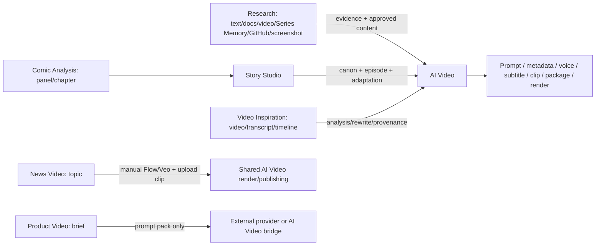

# Nghiên cứu cập nhật luồng nội dung AI Media

**Ngày kiểm tra:** 2026-10-02 (Asia/Saigon)

**Câu hỏi:** Luồng nội dung được mô tả trong tài liệu vận hành có còn khớp với mã nguồn, dữ liệu và giới hạn provider hiện tại không?
**Phạm vi diễn giải:** “luồng nội” được hiểu là **luồng nội dung đầu-cuối**: nhập nguồn/nghiên cứu → phát triển nội dung → handoff → prompt/metadata → clip/voice/phụ đề/render. Nếu người dùng muốn nói một luồng hẹp hơn, các bằng chứng dưới đây vẫn chỉ ra các điểm cần cập nhật.

## Kết luận

**Có, cần cập nhật tài liệu trước khi dùng lại để vận hành.** Mức ưu tiên cao nhất là sửa tài liệu “5 luồng”; nghiên cứu này không tự thay đổi code.

1. Tài liệu đang ghi **5 workspace** và ngày kiểm chứng **12/08/2026**, trong khi frontend hiện đăng ký **7 workspace media**: Research, AI Video, News Video, Product Video, Comic Series Analysis, Story Studio và Video Inspiration. Hai route News/Product chưa có trong bản đồ.
2. Dữ liệu mẫu không còn tái lập được trong database hiện tại: `research_projects`, `research_sources`, `research_runs`, `research_ideas`, `research_handoffs`, `comic_analysis_jobs`, `comic_source_documents`, `comic_panels` và `story_episodes` đều đang có 0 bản ghi. Vì vậy ID “Nghiên cứu Series: Người Que”, Coffeemanga và các số đếm trong tài liệu không còn là dữ liệu hiện hành.
3. Research đã mở rộng: có `github_repo`, `screenshot_upload`, snapshot theo commit, evidence theo dòng, giới hạn đọc và giữ ảnh gốc cho bước dựng video. Tài liệu 5 luồng chưa mô tả nhánh này.
4. AI Video có các đích auto-run `prompts_only`, `publishing_kit`, `video_clips`, `full_materials` và hai mode `review_gated`, `full_auto`. Metadata YouTube/TikTok/Facebook nằm giữa prompt và voice/clip tùy đích; tài liệu chưa mô tả điều kiện dừng và stale.
5. Flow/Veo là luồng thủ công/ngoài hệ thống với session, project binding và credit/model thay đổi theo tài khoản. Mã nguồn dùng model đang chọn trong Flow và không tự đổi model; tài liệu nên tránh khẳng định cố định “Veo 3” hoặc một mức credit, và phải yêu cầu kiểm tra model/credit hiện tại.

## Nguồn và phương pháp

Nguồn sở hữu hành vi được ưu tiên theo thứ tự: mã nguồn frontend/backend; service/schema thực thi; database hiện tại đọc-only; tài liệu vận hành; tài liệu chính thức của Google Flow/Veo và GitHub REST. Các nguồn ngoài được truy cập ngày 2026-10-02 và được liệt kê ở cuối file.

Đã kiểm tra route bằng:

```text
rg -n "path:|news-video|product-video|research|comic-series-analysis|story-studio|video-inspiration" app/src/router.tsx app/src/components/Sidebar.tsx
```

Đã truy vấn SQLite chỉ đọc các bảng `research_*`, comic, story, `video_inspiration_jobs`, `news_video_workflows` và `product_video_projects`. Không seed, reset, xóa hoặc ghi dữ liệu.

## Bằng chứng tài liệu đang dùng

| Nội dung | Bằng chứng | Nhận định |
|---|---|---|
| Tài liệu tự nhận là “5 workspace” | [`docs/huong-dan-5-luong-ai-media.html:8-9,817-818`](../huong-dan-5-luong-ai-media.html) | Tiêu đề và mô tả đã lệch route hiện tại. |
| Ngày kiểm chứng | `docs/huong-dan-5-luong-ai-media.html:813,1716` | ID, số đếm và trạng thái provider không nên được đọc như hiện trạng lâu dài. |
| Chỉ có năm liên kết workspace | `docs/huong-dan-5-luong-ai-media.html:821-827` | Thiếu `/news-video` và `/product-video`. |
| Hard-code Research “Người Que” và ID | `docs/huong-dan-5-luong-ai-media.html:885-889,1040-1066,1829-1839` | Không tái lập được với DB hiện tại. |
| AI Video có publishing metadata | `docs/huong-dan-5-luong-ai-media.html:1475-1533` | Hướng đúng, nhưng thiếu target auto-run, gate và stale dependency. |
| Timeout 600 giây | `docs/huong-dan-5-luong-ai-media.html:1115-1144` | Vẫn khớp hard cap Codex; cần tách khỏi timeout Flow/clip. |

## Route hiện tại

`app/src/router.tsx:85-92` coi các route sau là workspace rộng; route tree ở `:210-250,341-356` đăng ký chúng. `app/src/components/Sidebar.tsx:18-38` cũng hiển thị đủ các mục này.

| Route | Vai trò hiện tại | Nhóm tài liệu nên dùng |
|---|---|---|
| `/research` | Nguồn, study/evidence, ý tưởng/kịch bản, score, memory, handoff | Luồng nguồn cốt lõi |
| `/comic-series-analysis` | Ingest chapter/panel, analysis/rewrite, approval, handoff Story Studio | Luồng nguồn cốt lõi |
| `/story-studio` | Series/episode, canon, character, image adaptation, video adaptation/handoff | Luồng phát triển cốt lõi |
| `/video-inspiration` | Upload/link video, transcript/timeline/analysis/rewrite, handoff AI Video | Luồng nguồn cốt lõi |
| `/ai-video` | Story/scene/shot/prompt, publishing metadata, voice/subtitle/clip/package/render | Luồng sản xuất trung tâm |
| `/news-video` | News project, shot/prompt Veo, speech mode, upload clip, shared render/publishing | Luồng chuyên biệt |
| `/product-video` | Tạo shot và prompt pack; dừng ở prompt, không TTS/clip/render trong route này | Luồng chuyên biệt |

Có thể chọn một trong hai cách đặt tên:

- **“Bốn luồng nguồn + AI Video”**, kèm mục riêng cho News/Product; hoặc
- **“Bảy workspace media hiện tại”** nếu muốn bao quát mọi mục trong sidebar.

Không nên gọi cả bảy route là một pipeline tuyến tính. News/Product dùng primitive AI Video chung nhưng không có cùng handoff như Research/Comic/Story/Video Inspiration.

## Các cập nhật nội dung cần đưa vào

### Research: GitHub, screenshot và evidence-first

`backend/services/research.py:53-59` khai báo `screenshot_upload`, `github_repo` và `series_memory`; UI hiển thị hai lựa chọn mới ở `app/src/components/ResearchWorkspace/SourcePanel.tsx:27-34`.

`backend/services/research_repository.py:105-183` hiện thực luồng:

1. Kiểm tra URL public HTTPS của GitHub.
2. Resolve ref/branch về commit SHA và tree SHA.
3. Chọn file tài liệu/cấu hình/source trong ngân sách; bỏ build/vendor/node_modules.
4. Đọc file theo commit SHA, kiểm tra blob SHA, lưu evidence theo path và line range.
5. Ghi limitation rằng không thực thi code/benchmark và tree có thể bị truncated.

`research_repository.py:186-249` buộc facts phải trỏ tới evidence ID, phân biệt `documented`, `source_reviewed`, `observed` và chặn option sáng tạo không có fact. `research_screenshots.py:36-113` giữ SHA/ảnh gốc, chỉ ghi chữ/vùng nhìn thấy và không coi screenshot là bằng chứng code đã chạy.

Tài liệu nên thêm nhánh:

```text
GitHub repo/screenshot → snapshot commit + evidence → study facts + limitations
→ hook/ý tưởng có dẫn chứng → preserve-source handoff → crop/zoom/highlight ảnh gốc
```

Không nên viết rằng Research “đọc và chạy repo”: package collector đặt `executed: false` và ghi giới hạn ở `research_repository.py:173-182`.

### News Video: manual Flow/Veo và speech contract

Frontend mô tả ở `app/src/components/NewsVideo/NewsVideo.tsx:61-84`:

```text
Nhập tin → sinh shot → sinh prompt Veo → copy sang Flow/Veo
→ người dùng tự render/tải MP4 → chọn đúng shot upload clip → render chung
```

Ba speech mode ở `NewsVideo.tsx:14-18` và `backend/routes/news_video.py:63-71`:

- `veo_dialogue`: nhân vật nhìn thấy nói câu thoại, khớp khẩu hình.
- `voicebox_khong_context`: Veo không nói; Voicebox tạo TTS hậu kỳ.
- `veo_narration`: Veo đọc lời dẫn ngoài khung hình.

UI ghi rõ hệ thống **không tự mở Veo và không tự tiêu credit** (`NewsVideo.tsx:80-84`). Backend có upload clip, render readiness/jobs, voice và publishing metadata (`backend/routes/news_video.py:206-406`). Tài liệu cần thêm cảnh báo manual handoff và bước upload clip, thay vì gom News vào mô tả AI Video chung.

### Product Video: prompt-only

Comment contract ở `app/src/lib/api/client.ts:3423-3425` nêu rõ Product Video dừng tại prompt pack: **không clip generation, không TTS, không render**. Backend `backend/routes/product_video.py:1-4,80-145` chỉ tạo project, plan shots, sinh prompt và tải prompt pack.

Nên mô tả:

```text
Product brief → product shots → prompt pack → provider ngoài hoặc AI Video bridge
```

Không nên ghi Product Video đã tạo MP4 hoặc đã đi qua voice/subtitle.

### AI Video: artifact và auto-run

Hợp đồng trong `backend/models.py:2377-2382` cho phép mode `review_gated`/`full_auto` và target `prompts_only`/`publishing_kit`/`video_clips`/`full_materials`.

`backend/features/ai_video/auto_runs.py:848-920` thể hiện thứ tự hiện tại:

```text
story/shot → prompt → (nếu target cần) publishing metadata
→ review_prompts hoặc auto-approve
→ prompts_only: kết thúc
→ publishing_kit: kết thúc
→ video_clips/full_materials: clip → voice → subtitle/package/render readiness
```

Publishing metadata canonical chỉ có YouTube, TikTok và Facebook (`backend/services/video_publishing_metadata.py:35-46,63-105`). Đây là artifact để copy/export, có revision/fingerprint/stale; không phải tích hợp đăng bài tự động. Chỉ coi metadata ready khi đủ cả ba platform, `completed` và không stale (`video_publishing_metadata.py:716-729`).

| Target | Kết thúc tối thiểu | Voice/subtitle |
|---|---|---|
| `prompts_only` | Story/shot/prompt + gate prompt | Không bắt buộc |
| `publishing_kit` | Prompt + metadata 3 platform + gate prompt | Không chạy |
| `video_clips` | Prompt + metadata + clip readiness | Theo phần còn lại của runner |
| `full_materials` | Prompt + metadata + voice + subtitle + package/render readiness | Có, sau gate/dependency hợp lệ |

Nên giữ cảnh báo: `prompts_ready` không đồng nghĩa MP4 hoàn tất. [`docs/ai-video-workflow-architecture.md`](../ai-video-workflow-architecture.md) mô tả dependency scope, stale transaction và module backend; nên liên kết tài liệu này thay vì nhồi toàn bộ chi tiết vào guide vận hành.

### Flow/Veo: model, capability và credit phải có ngày kiểm tra

Voicebox không hard-code model cụ thể: `backend/services/video_provider_project_bindings.py:24-25` dùng `use_current_flow_selection` và cấm tự động đổi model. Adapter `backend/services/video_veo_chrome.py:1,21-31` lái web Flow bằng Chrome CDP; timeout generation mặc định 20 phút/clip và download 10 phút.

Google Flow Help hiện mô tả Veo 3.1 Lite/Fast/Quality với tính năng khác nhau; Ingredients/References to Video chỉ hỗ trợ video 8 giây trong bảng tính năng hiện tại. Trang credit tính theo **generation** và hạn mức phụ thuộc gói/tài khoản. Các chi tiết này có thể đổi, nên guide cần dẫn link chính thức và yêu cầu người dùng kiểm tra model, resolution và credit ngay trong Flow.

Google Gemini API là đường khác với Flow web. Tài liệu API có Veo 3.1 và long-running operation; không dùng giá/giới hạn API để suy ra credit Google Flow. Code hiện tại lái Flow web, không gọi Veo REST API.

### Dữ liệu mẫu phải bỏ ID cứng hoặc đóng gói fixture có phiên bản

Snapshot `data/voicebox.db` ngày 2026-10-02:

| Bảng | Số bản ghi |
|---|---:|
| `research_projects` | 0 |
| `research_sources` | 0 |
| `research_runs` | 0 |
| `research_ideas` | 0 |
| `research_handoffs` | 0 |
| `comic_analysis_jobs` | 0 |
| `comic_source_documents` | 0 |
| `comic_panels` | 0 |
| `story_episodes` | 0 |
| `video_inspiration_jobs` | 6 |
| `news_video_workflows` | 1 |
| `product_video_projects` | 21 |

ID `229f1f94-18bd-4b15-a22d-9a078d7689e3` không xuất hiện trong `research_projects`; record Coffeemanga cũng không thể mở từ các bảng comic/story rỗng. Phần “Hồ sơ thật dùng trong hướng dẫn” vì vậy phải đánh dấu **stale**, không phải lỗi lazy-load.

Đề xuất:

- Guide chung không nhúng ID; hướng dẫn chọn record hiện có và ghi ID/request ID sau thao tác.
- QA có chủ đích dùng fixture/seed có tên và version rõ, kèm verifier tồn tại.
- Mỗi lần kiểm chứng ghi `verified_at`, branch/commit và snapshot record; không giữ các số đếm như 21 ý tưởng/revision 3 làm sự thật lâu dài.

### Provider readiness: sửa claim model/reasoning

Guide ghi một lần kiểm tra trả `gpt-5.6-sol / low`. Runtime default hiện tại là `gpt-5.6-sol`, reasoning `ultra`, timeout hard cap 600 giây (`backend/services/ai_planning.py:24-28,579-582`); Settings/env có thể override. Copy nên là:

> Mở Settings để kiểm tra provider của phiên hiện tại. Default runtime là `gpt-5.6-sol/ultra`, nhưng cấu hình người dùng có thể thay đổi; không dùng request ID cũ để kết luận trạng thái mới.

600 giây là cap của Codex planning. Flow generation/download có timeout riêng (`video_veo_chrome.py:21-23`), nên không gọi chung là “provider timeout”.

## Bản đồ luồng đề xuất



Copy nên phân biệt:

- **Pipeline nội dung cốt lõi:** Research, Comic Analysis, Story Studio, Video Inspiration → AI Video.
- **Luồng chuyên biệt:** News Video có manual Flow/Veo và speech contract; Product Video là prompt-only.

## Danh sách cập nhật theo ưu tiên

### P0 — cập nhật trước vòng QA tiếp theo

- Đổi tiêu đề/ngày kiểm chứng và số workspace; thêm News/Product hoặc nêu rõ ngoài phạm vi.
- Xóa ID/số đếm Research, Comic, Story không còn trong DB; dùng record động hoặc fixture có version.
- Sửa provider claim `low` thành “kiểm tra Settings”; ghi default `gpt-5.6-sol/ultra` và tách timeout Codex 600 giây khỏi Flow timeout.

### P1 — cập nhật trong cùng phiên bản tài liệu

- Thêm Research GitHub/screenshot/evidence-first và preserve-source.
- Thêm sơ đồ News manual Flow/Veo và Product prompt-only.
- Mô tả target/mode auto-run, metadata 3 platform, review gate và stale.
- Liên kết [`docs/ai-video-workflow-architecture.md`](../ai-video-workflow-architecture.md).

### P2 — làm tài liệu bền hơn

- Thêm mục “nguồn ngoài thay đổi” với link Flow Help, credit page và Gemini API; luôn kiểm tra model/credit tại thời điểm chạy.
- Ghi `verified_at`, commit/branch, DB snapshot và request ID cho mỗi QA run.
- Thêm verifier read-only kiểm tra route inventory, fixture IDs và số workspace trước khi xuất bản.

## Giới hạn nghiên cứu

- Database là snapshot local, không đại diện cho mọi máy hoặc deployment.
- Chưa chạy provider Flow/Veo thật và không suy ra account credit/login từ code local.
- Chưa browser-QA mọi nút; kết luận route/contract dựa trên source code và API schema.
- Giới hạn model/credit của Google có thể thay đổi; phần provider chỉ là hướng dẫn kiểm tra tại thời điểm chạy.

## Nguồn chính thức

### Trong repository

- [`docs/huong-dan-5-luong-ai-media.html`](../huong-dan-5-luong-ai-media.html) — tài liệu được đối chiếu.
- [`app/src/router.tsx`](../../app/src/router.tsx) và [`app/src/components/Sidebar.tsx`](../../app/src/components/Sidebar.tsx) — route/sidebar hiện tại.
- [`backend/services/research.py`](../../backend/services/research.py), [`research_repository.py`](../../backend/services/research_repository.py), [`research_screenshots.py`](../../backend/services/research_screenshots.py) — source/evidence.
- [`backend/routes/news_video.py`](../../backend/routes/news_video.py), [`NewsVideo.tsx`](../../app/src/components/NewsVideo/NewsVideo.tsx) — News manual Flow/Veo.
- [`backend/routes/product_video.py`](../../backend/routes/product_video.py), [`app/src/lib/api/client.ts`](../../app/src/lib/api/client.ts) — Product prompt-only.
- [`backend/features/ai_video/auto_runs.py`](../../backend/features/ai_video/auto_runs.py), [`video_publishing_metadata.py`](../../backend/services/video_publishing_metadata.py), [`backend/models.py`](../../backend/models.py) — auto-run/publishing.
- [`video_provider_project_bindings.py`](../../backend/services/video_provider_project_bindings.py), [`video_veo_chrome.py`](../../backend/services/video_veo_chrome.py) — Flow binding/model selection/timeouts.
- [`docs/ai-video-workflow-architecture.md`](../ai-video-workflow-architecture.md) — dependency/stale/backend architecture.
- [`data/voicebox.db`](../../data/voicebox.db) — local DB snapshot used for read-only counts; not a portable fixture.

### Ngoài repository

- [Google Flow: models and supported features](https://support.google.com/flow/answer/16352836) — model/features, aspect ratio, duration và Ingredients/References.
- [Google Flow: manage credits](https://support.google.com/flow/answer/16526234) — credit theo generation và quota theo plan.
- [Google AI for Developers: video generation with Veo](https://ai.google.dev/gemini-api/docs/video) — Veo 3.1 API và long-running operation; là đường API khác Flow web.
- [GitHub REST: repository contents](https://docs.github.com/en/rest/repos/contents) — giới hạn Contents API.
- [GitHub REST: Git trees](https://docs.github.com/en/rest/git/trees) — snapshot tree và giới hạn recursive/truncated.
